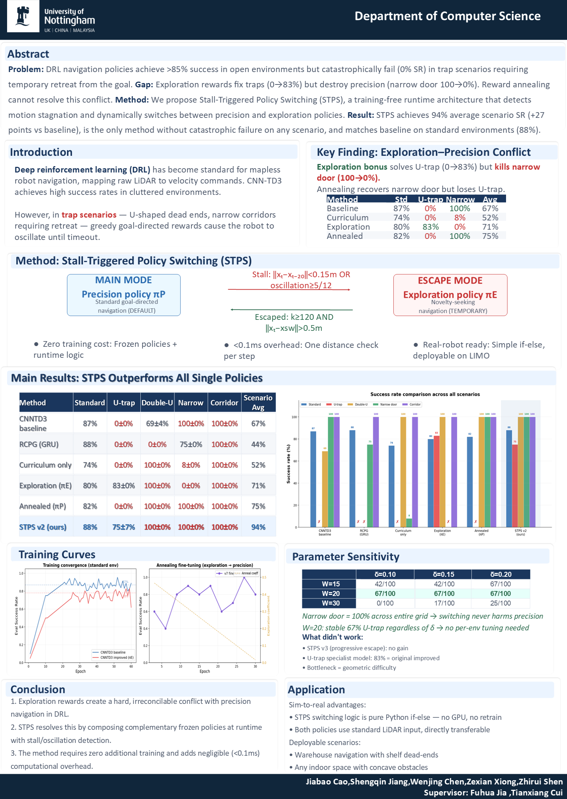

[English](README.md) · [简体中文](README.zh-CN.md)

# STPS: Robot Navigation Beyond Dead Ends

**A FURP team study of escaping navigation traps while preserving precision in narrow passages.**

**[Research poster (PDF)](FURP_Showcase.pdf) · [Presentation (PPTX)](FURP_Showcase.pptx)**

[](FURP_Showcase.pdf)

## Value and contributions

Goal-directed robots can stall inside U-shaped obstacles. Exploration rewards help escape but can reduce the precision needed for narrow doors. The team proposes **Stall-Triggered Policy Switching (STPS)**: switch between complementary frozen precision and exploration policies when motion stalls.

**Zexian Xiong (Sean)** is a co-author of the team poster. His [project record](docs/00_weekly_CN.md) documents environment setup, GridWorld navigation, IR-SIM scenario construction and random-policy evaluation, alongside ROS2/SLAM/Nav2 integration experiments. These materials demonstrate simulation, Python evaluation and navigation failure analysis. They do not establish individual ownership of every STPS component; STPS findings are credited to the team.

## Method and evidence

The poster switches to exploration when displacement over 20 steps is below 0.15 m or oscillation reaches 5/12. It returns after at least 120 escape steps and displacement above 0.5 m. The switch composes previously trained policies without additional training.

| Evidence | Result | Reproduction status |
| --- | --- | --- |
| Team poster: STPS v2 | Reported scenario average SR 94% versus 67% baseline; U-trap 75±7%; narrow door 100%; standard environment 88% | Poster only; STPS source, checkpoints and raw trials are absent |
| GridWorld BFS | 18 moves, 19 positions, return 2 | Included runnable script |
| Archived basic-world random policy | 10 episodes: SR 0%, CR 10%, TR 90% | CSV metrics can be recomputed |
| Archived U-trap random policy | 10 episodes: SR 0%, CR 100%, TR 0% | CSV metrics can be recomputed |

The poster's scenario average excludes the separate standard environment: (75 + 100 + 100 + 100) / 4 = 93.75%, rounded to 94%. The ± notation, trial counts and seeds are not fully specified. Team results, overhead and robot deployment claims are **not independently verified here**. `sample_eval_results.csv` is illustrative, not experimental evidence.

## Quick start

CSV evaluation uses only Python's standard library; no GPU, account, paid service or downloaded dataset is needed.

```sh
git clone https://github.com/Sean-xzx/FURP-2026-Zexian-Xiong-RL-Navigation-for-AMR.git
cd FURP-2026-Zexian-Xiong-RL-Navigation-for-AMR
python src/eval/evaluate_csv.py --file results/u_trap_random_eval.csv
```

Expected final line:

```text
SR=0.00%, CR=100.00%, TR=0.00%, AvgSteps=44.40, AvgPathLength=2.23, N=10
```

For GridWorld and IR-SIM, create a Python 3.12 environment:

```sh
python -m venv .venv
# Windows PowerShell:
.venv\Scripts\Activate.ps1
# Linux/macOS shells instead: source .venv/bin/activate
python -m pip install -r requirements/reproducible.txt
python tools/verify_project.py
python tools/run_random_baseline.py --seed 42 --world src/irsim_env/worlds/u_trap_world.yaml --scenario u_trap --goal-x 5 --goal-y 9 --episodes 2 --max-steps 100 --output artifacts/u_trap_seed42.csv
python src/eval/evaluate_csv.py --file artifacts/u_trap_seed42.csv
```

Verification checks GridWorld, archived metrics and simulator behavior, writing generated files to `artifacts/`. Random runs produce episode CSVs, not the poster's trained-policy results. Installation requires internet and may take several minutes; short CPU examples generally finish in seconds. See [reproduction instructions](docs/REPRODUCIBILITY.md) for configuration, environments and limitations.

## Structure and data flow

- `FURP_Showcase.pdf`, `FURP_Showcase.pptx`: team presentation; `docs/assets/` contains its preview.
- `src/irsim_env/worlds/`: YAML geometry, starts and goals. `evaluate_random_policy.py` sends random velocities to IR-SIM and records episode CSVs.
- `src/eval/`: CSV loading and aggregation of success rate (SR), collision rate (CR), timeout rate (TR), steps and path length.
- `docs/evidence-week01/`: independent BFS GridWorld script and original evidence.
- `results/`: original tables preserved byte for byte. `tools/` adds seeded launch and verification without changing core code.
- `tests/`, `.github/workflows/verify.yml`: regression tests and CI. `docs/` retains historical notes.

The runnable flow is **world YAML → simulator + random actions → episode CSV → metrics**. GridWorld separately verifies discrete shortest paths. STPS policy switching is described in the poster but is not implemented in this checkout.

## Status, development and rights

This is a research showcase with runnable early experiments. ROS2, Gazebo, Cartographer, Nav2, Qwen and Habitat milestones are historical records; complete launch files, maps and scene assets are absent. Trained STPS reproduction and hardware deployment remain unavailable. Historical random runs lack seeds; an older demo overcounts timeout steps. See [validation](docs/VALIDATION.md) for executed checks.

Run `python -m unittest discover -s tests -v` for standard-library tests, or `python tools/verify_project.py` after installing dependencies. Use [GitHub Issues](https://github.com/Sean-xzx/FURP-2026-Zexian-Xiong-RL-Navigation-for-AMR/issues) with commands, environment and errors, excluding credentials. Seek permission before reuse or modification.

**All rights reserved. No open-source license is granted.** Public visibility permits viewing through the platform; other use, redistribution or modification requires permission from the relevant rights holders. Team attribution and third-party rights remain intact. See [RIGHTS.md](RIGHTS.md).
